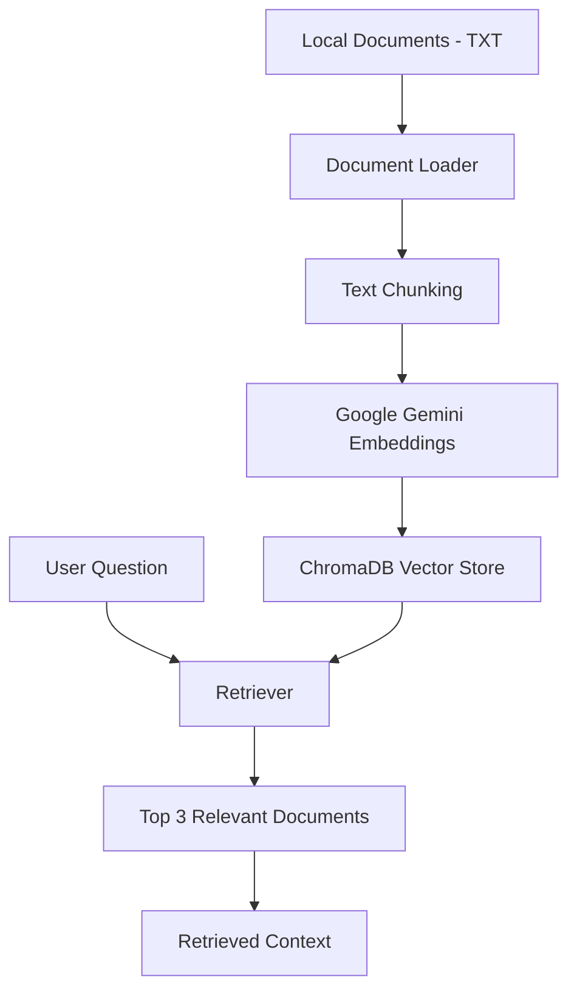

# RAG Chatbot Demo

A Python-based **Retrieval-Augmented Generation (RAG)** project that demonstrates how to load documents, split text into smaller chunks, generate embeddings, store them in a vector database, and retrieve relevant information based on user queries.

The project uses **LangChain, Google Gemini Embeddings, and ChromaDB** to implement the document retrieval pipeline.

## Overview

Large Language Models (LLMs) have limitations when answering questions about private, company-specific, or frequently updated information.

Retrieval-Augmented Generation (RAG) addresses this by retrieving relevant information from an external knowledge source before generating an answer.

This project demonstrates the core RAG retrieval workflow:

1. Load documents from a local directory.
2. Split documents into smaller text chunks.
3. Generate vector embeddings using Google Gemini.
4. Store embeddings in ChromaDB.
5. Retrieve relevant document chunks using semantic similarity.
6. Display the retrieved documents for a user query.

## Architecture



## Technology Stack

| Technology | Purpose |
|---|---|
| Python 3.14+ | Core programming language |
| LangChain | RAG application framework |
| Google Gemini Embeddings | Text embedding generation |
| ChromaDB | Vector database and persistence |
| RecursiveCharacterTextSplitter | Document chunking |
| PyPDF | PDF document loading dependency |
| uv | Python dependency and environment management |
| Groq / Google GenAI integrations | Available model integrations |

## Project Structure

```text
rag_chatbot_demo/
│
├── data/
│   ├── *.txt              # Source documents
│   └── chroma_db/         # Persistent vector database
│
├── src/
│   └── rag_chatbot/
│       └── main.py        # RAG implementation
│
├── pyproject.toml         # Project configuration
├── uv.lock                # Locked dependencies
├── .gitignore
└── LICENSE
```

## How RAG Works

### 1. Document Loading

The application loads text documents from the `data/` directory using LangChain's `DirectoryLoader`.

### 2. Text Chunking

Documents are divided into smaller chunks using `RecursiveCharacterTextSplitter`.

Current configuration:

```python
chunk_size = 100
chunk_overlap = 20
```

Chunk overlap helps preserve context between consecutive text segments.

### 3. Embedding Generation

Google Gemini converts text chunks into numerical vector representations.

```python
embeddings = GoogleGenerativeAIEmbeddings(
    model="gemini-embedding-2",
    google_api_key=os.environ.get("GOOGLE_API_KEY")
)
```

### 4. Vector Database

ChromaDB stores document embeddings for similarity-based retrieval.

```python
vectorstore = Chroma.from_documents(
    documents=chunks,
    embedding=embeddings,
    persist_directory="data/chroma_db"
)
```

### 5. Semantic Search

When a user submits a question, the retriever searches for the three most relevant document chunks.

```python
retriever = vectorstore.as_retriever(
    search_type="similarity",
    search_kwargs={"k": 3}
)

retrieved_docs = retriever.invoke(question)
```

## Prerequisites

- Python 3.14 or higher
- uv package manager
- Google AI API key
- Internet connection for embedding generation

## Installation

### 1. Clone the repository

```bash
git clone https://github.com/rexShail/rag_chatbot_demo.git

cd rag_chatbot_demo
```

### 2. Install dependencies

```bash
uv sync
```

### 3. Configure environment variables

Create a `.env` file in the project root:

```env
GOOGLE_API_KEY=your_google_api_key
```

Get your API key from:

https://aistudio.google.com/apikey

### 4. Add documents

Place your `.txt` documents inside the `data/` directory.

The current implementation scans for files matching:

```text
data/**/*.txt
```

### 5. Run the application

```bash
uv run python src/rag_chatbot/main.py
```

## Example Usage

After the application loads the documents and creates embeddings, it prompts:

```text
Enter your question:
```

Example:

```text
Enter your question: What is Retrieval Augmented Generation?
```

The retriever returns the three most relevant document chunks.

**Note:** The current implementation demonstrates document retrieval and prints the retrieved documents. It does not yet pass the retrieved context to an LLM to generate a conversational answer.

## Current Capabilities

- Local text document ingestion
- Document chunking and overlap
- Google Gemini embedding generation
- ChromaDB vector storage
- Persistent vector database directory
- Similarity-based document retrieval
- Interactive terminal-based question input

## Future Enhancements

The following are potential improvements to evolve this project into a complete RAG chatbot:

- [ ] Add PDF document ingestion.
- [ ] Integrate an LLM for answer generation using retrieved context.
- [ ] Add conversational memory and chat history.
- [ ] Implement source citations for generated answers.
- [ ] Add configurable chunk size and overlap.
- [ ] Add metadata filtering.
- [ ] Implement document upload functionality.
- [ ] Build a Streamlit or FastAPI interface.
- [ ] Add support for multiple LLM providers.
- [ ] Add evaluation metrics for retrieval quality.
- [ ] Add Docker support.
- [ ] Implement incremental document ingestion and vector-store updates.

## Learning Objectives

This project is useful for understanding:

- What Retrieval-Augmented Generation is.
- Why embeddings are required in AI applications.
- How vector databases work.
- How semantic search differs from keyword search.
- How document chunking affects retrieval quality.
- How LangChain connects document loaders, embedding models, and vector stores.

## License

This project is licensed under the MIT License. See [LICENSE](LICENSE) for details.

## Author

**Shail S**

GitHub: https://github.com/rexShail

LinkedIn: https://www.linkedin.com/in/rexshail/

---

If you find this project useful, consider giving it a ⭐ on GitHub.

